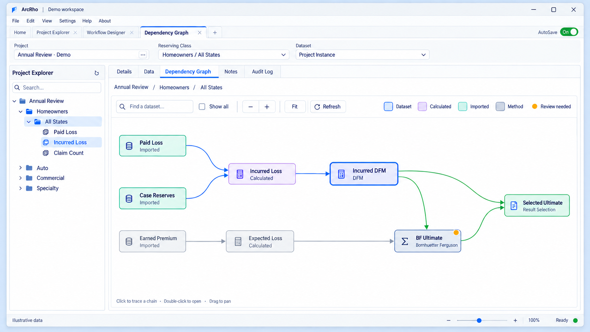
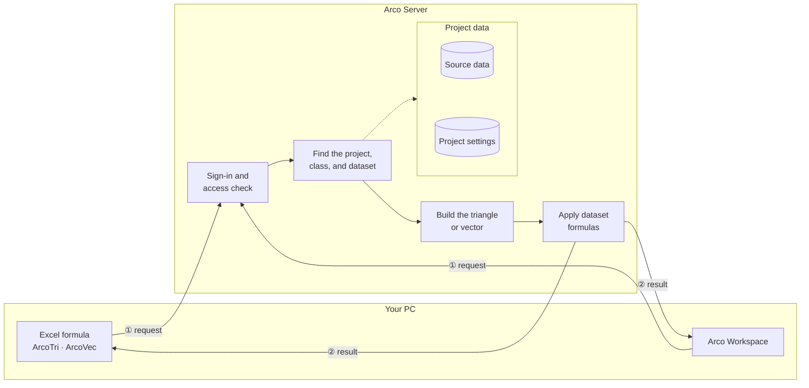

# Actuarial Reserving Co-intelligence

Arco (**A**ctuarial **R**eserving **Co**-intelligence) is an actuarial data automation platform focused on loss reserving analytics, with an emphasis on streamlining the end-to-end data preparation pipeline.
It provides a structured framework for transforming raw insurance loss data into reproducible reserving workflows — eliminating manual data handling, accelerating turnaround, and giving actuaries full transparency and control over their assumptions.

## Background & Motivation

Reserving teams face shifting claims patterns, extraordinary loss events, and rapid operational changes, but their tools often lag behind. Workflows still rely on rigid vendor platforms, Excel worksheets, and manual handoffs.

The core problem is structural: traditional project hierarchies require pre-computing datasets, store thousands of rarely used outputs, and need manual updates when coverage or company structures change.

Arco replaces that model with on-demand queries against analytics-ready source data, exposed through familiar Excel formulas. It reduces manual transfer, removes vendor dependency, and helps reserving teams respond faster.

## A Modern Workspace for a Seamless User Experience
The images below are illustrative UI demos with sample data.

Arco Workspace, the desktop app, gives actuaries a flexible workspace for customizing, retrieving, and reviewing triangle datasets without rebuilding a project structure. Users can pull any configured dataset at the level or segment they need, switch assumptions quickly, and use multiple built-in visualization presets to inspect trends, compare patterns, and validate selections before moving deeper into the analysis.

## A New Way to Work with Reserving Methods

Arco keeps familiar actuarial methods at the center, then equips them with modern, user-friendly tools that make method review faster and more transparent. The goal is not only to provide accurate data, but to help actuaries reach more accurate insights through clearer assumptions, easier interaction, and more productive review workflows.

## Versioned Reserving Methods with Built-in Controls

Method Version Compare helps teams review any two historical versions of a chain-ladder method before adopting changes. The comparison view highlights which version is newer, shows side-by-side snapshots of ratio selections, formulas, and notes, and lets users choose which version to keep. This gives actuaries a clear review step before overwriting assumptions, reducing accidental drift while keeping collaboration fast.

## Trace Dependencies Within a Project

The Dependency Graph shows how datasets feed calculations, reserving methods, and result selections within a reserving class. Select a node to highlight its upstream inputs in blue and downstream dependents in green. Search for a dataset, pan and zoom through the graph, or double-click a node to open its dataset or method. Review indicators help identify objects that need attention.

---

## Data Processing Engine

Arco replaces the traditional vendor-based reserving database with a lightweight calculation engine that queries source data tables on demand, builds loss triangles as they are requested, and returns results directly to Excel or Arco Workspace — with no pre-computation, no rigid project hierarchy, and no lengthy load times.

### Architecture Overview

### How It Works

**1. Send a request from the frontend**
Users call Arco functions directly in Excel, such as `=ArcoTri(...)`, to get a loss triangle dataset. Each request tells Arco which project, reserving class, and dataset to retrieve. Arco Workspace sends the same kind of request when a dataset is opened.

**2. Find the right data**
Arco reads the project setup, filters the source data to the requested segment, and uses the configured dataset definitions to determine what should be returned.

**3. Build the result on demand**
Instead of pre-building thousands of triangles, Arco constructs only the triangle or vector needed for the current request. Frequently used data is kept ready so repeated requests are fast.

---

### Advantages Over Traditional Reserving Databases

| | Arco | Traditional Vendor Platform |
|---|---|---|
| **Data structure** | One detailed source data table | Fixed hierarchical project tree |
| **Project setup** | Edit project settings in Arco Workspace | Rebuild project hierarchy in vendor software |
| **Computation model** | On-demand, per request | Pre-compute all datasets before access |
| **Storage footprint** | Only source data stored | 10,000+ pre-computed datasets per project |
| **New class / coverage** | Update the project settings; requests resolve immediately | Manual intervention to fix aggregation dependencies |
| **Custom aggregations** | Define new reserving class types at any time | Requires project rebuild |
| **Excel integration** | Drop-in worksheet functions matching familiar syntax | Vendor-bundled Excel Add-In |
| **Infrastructure** | Lightweight server, no vendor application | Depends on remote server / vendor application |

---

## Excel Add-in

The Arco Excel Add-in brings the data processing engine directly inside Excel through a set of worksheet functions and a custom **Arco** ribbon tab. Actuaries work entirely within familiar Excel workflows — no scripting, no vendor software — while Arco handles all data retrieval and triangle construction behind the scenes.

### Ribbon

The **Arco** ribbon tab groups the add-in's commands:

| Group | Buttons | Purpose |
|---|---|---|
| **Unlimited Remote Access** | **Connect and Login** | Signs in to the Arco server |
| | **Refresh Worksheet** · **Refresh Workbook** | Recalculates every Arco formula on the active sheet or in the whole workbook |
| **Shortcuts** | **Insert Function** | Inserts an Arco function into the active cell |
| | **Clear Formulas** | Removes all Arco formulas from the active sheet |
| | **Load Reserving Classes** | Opens a dialog to select and confirm a reserving class path (e.g. `Demo Insurance\Homeowners\All States\All Channels\Property`) |
| | **Select Datasets** | Opens a searchable list of all available datasets for the active project |
| | **Copy Range Address** | Copies the address of the selected range |
| **Add-in Settings** | **Reset Add-in References** · **Load and Calculate** · **Unload Add-In** | Repairs, loads, or unloads the add-in |
| **Options** | **Check Updates** · **Settings** · **About** | Update check, preferences, and version details |

### Step 1 — Select a Reserving Class Path

Click **Load Reserving Classes** in the ribbon. The dialog presents a cascading set of dropdowns corresponding to the reserving class hierarchy (Company → Product → State → Channel → IBNR Category). Each selection narrows the next level. The resulting path (shown at the bottom of the dialog) is what you pass as the `Path` argument to any Arco function.

### Step 2 — Select a Dataset

Click **Select Datasets** to browse all datasets defined for the active project. Results can be filtered by name, category, or data format. The selected dataset name maps directly to the `TriangleName` / `VectorName` argument in the formulas below.

---

### Function Reference

All functions use the `Arco` prefix.

| Function | Category | Description | Arguments |
|---|---|---|---|
| `ArcoTri` | Triangle | Returns a full loss triangle as a spilled array | `Path`, `TriangleName`, `[Cumulative]`, `[Transposed]`, `[Calendar]`, `[ProjectName]`, `[OriginLength]`, `[DevelopmentLength]` |
| `ArcoTriDiag` | Triangle | Extracts a single diagonal. `DiagonalIndex = 0` = latest; negative values step back | `Path`, `TriangleName`, `[DiagonalIndex]`, `[Cumulative]`, `[Transposed]`, `[ProjectName]`, `[OriginLength]`, `[DevelopmentLength]` |
| `ArcoTriOrigin` | Triangle | Returns one origin-period row across all development ages | `Path`, `TriangleName`, `OriginPeriod`, `[Cumulative]`, `[Transposed]`, `[ProjectName]`, `[OriginLength]`, `[DevelopmentLength]` |
| `ArcoTriCell` | Triangle | Returns a single cell value at a specified origin and development position | `Path`, `TriangleName`, `OriginPeriod`, `DevelopmentPeriod`, `[Cumulative]`, `[ProjectName]`, `[OriginLength]`, `[DevelopmentLength]` |
| `ArcoVec` | Vector | Returns a one-dimensional origin-period vector (e.g. earned exposure, premium) | `Path`, `VectorName`, `[Transposed]`, `[ProjectName]`, `[PeriodLength]` |
| `ArcoVecCell` | Vector | Returns a single element from a vector by 1-based index | `Path`, `VectorName`, `Index`, `[ProjectName]`, `[PeriodLength]` |
| `ArcoHeaders` | Utility | Returns axis labels for triangle headers. `periodType = 0` = origin labels; `1` = development age labels | `periodType`, `Transposed`, `[PeriodLength]`, `[ProjectName]` |
| `ArcoProjectSettings` | Utility | Returns project details: name, origin type, start/end dates, development end date, period lengths | `[ProjectName]` |
